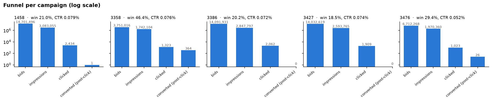
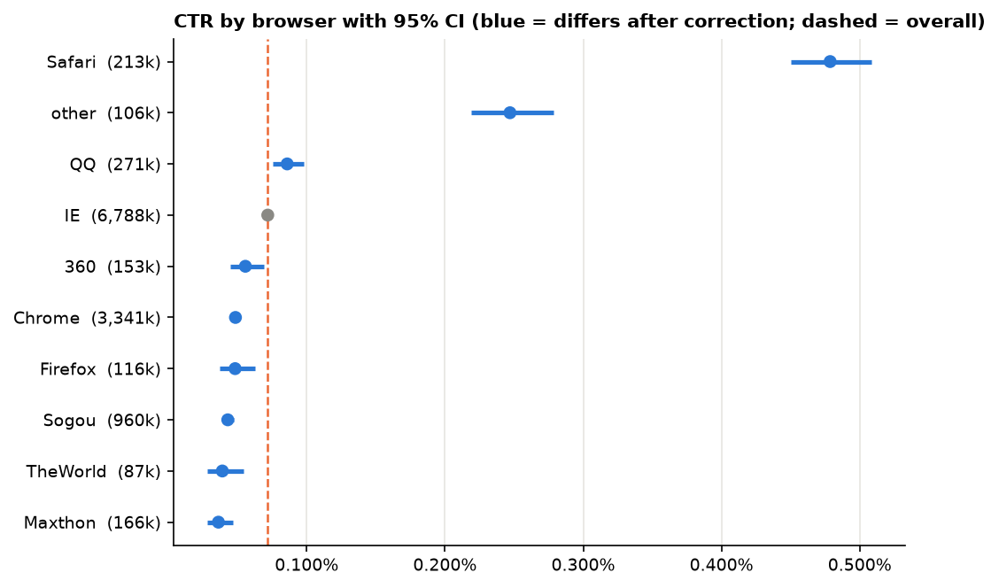
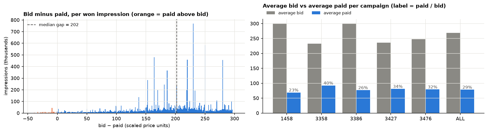
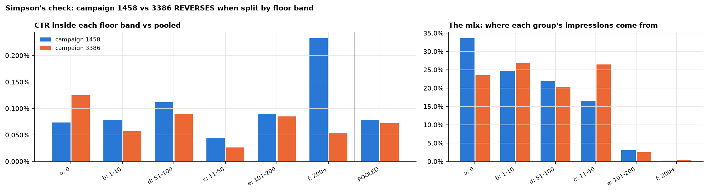
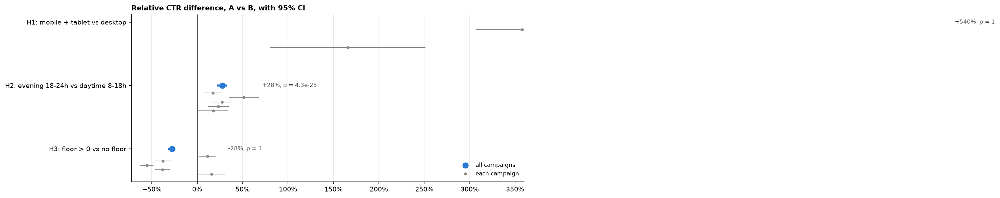

# Five things the advertiser should know

*iPinYou Season 2 · five campaigns (1458, 3358, 3386, 3427, 3476) · 6–12 June 2013 · prices are scaled values per 1,000 impressions*

## 1. One impression in 1,398 is clicked; one bid in 4.4 wins

**The number:** 53,289,330 bids → 12,237,081 impressions (win rate 23.0%) → 8,751 clicked (CTR 0.072%, 95% CI 0.070%–0.073%) → 391 post-click conversions; CPM 78.3, CPC 110

**How confident:** High (exact counts, reconciled with the dataset paper)

**What it means for the advertiser:** Expected value of 1,000 impressions = 1,000 × P(click) × P(conversion | click) × value per conversion = 0.72 clicks × 4.5% × value. To hit a target CPA T, CPM must stay below 0.032 × T. This is the yardstick for every bid.

## 2. Browser drives CTR: Safari vs Maxthon

**The number:** Safari 0.479% (95% CI 0.450%–0.509%, +644% vs rest) vs Maxthon 0.036% (-50%); 279 of 481 segment tests survive the multiple-comparison correction

**How confident:** High (q < 0.001)

**What it means for the advertiser:** Shift budget toward Safari and test a lower bid on Maxthon. This is a correlation, so confirm with a controlled bid test.

## 3. We pay 29% of what we bid

**The number:** average bid 268 vs average paid 78 (median gap 202); 1458: 23%; 3358: 40%; 3386: 26%; 3427: 34%; 3476: 32%

**How confident:** High (exact over 12,237,087 impressions)

**What it means for the advertiser:** Second-price auctions hide a large overbid. Under first-price auctions the same bids would cost 3.4× as much, so bid shading toward the market price is the main saving.

## 4. Simpson's paradox: campaign 1458 vs 3386 flips when split by floor band

**The number:** pooled +9% (p = 0.0038) vs within floor bands -0% (CMH p = 0.94); 15 of 99 comparisons reverse

**How confident:** Low (p = 0.94, not significant)

**What it means for the advertiser:** Pooled numbers can point budget the wrong way here. Always compare within a campaign, or adjust for the mix.

## 5. H2: Evening CTR (18-24h) is higher than daytime CTR (8-18h): supported

**The number:** evening 18-24h 0.082% vs daytime 8-18h 0.064%: +28% (95% CI +22% to +33%), p = 4.28e-25

**How confident:** High (p < 0.001)

**What it means for the advertiser:** A real difference worth acting on with a bid adjustment, after a controlled test.

---
*Method: rates are ratios of sums. 95% Wilson intervals. Segment tests are corrected for multiple comparisons (Benjamini–Hochberg). Clicks and conversions are linked to impressions by bid ID, user and time, and reported on the impression date. Details are in Notebooks 01–09.*